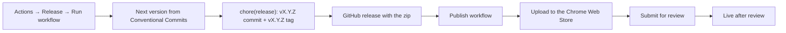

# Releasing to the Chrome Web Store

Releases are started by hand and everything after that is automatic.



| Workflow | Trigger | What it does |
|---|---|---|
| `.github/workflows/ci.yml` | push to `main`, pull requests | Checks commit messages, runs tests, builds and uploads the zip as an artifact |
| `.github/workflows/release.yml` | manual (Actions tab) | Picks the version, commits it, tags `vX.Y.Z`, creates the GitHub release, calls Publish |
| `.github/workflows/publish.yml` | called by Release, or manual with a tag | Uploads that release's zip to the store and submits it for review |

## How the version is chosen

The Release workflow looks at the commits since the last `v*` tag (see [CONTRIBUTING.md](../CONTRIBUTING.md)):

- any breaking change → major
- otherwise any `feat` → minor
- otherwise any `fix` or `perf` → patch
- otherwise nothing to release; the run fails and says so

The **bump** input overrides this (`patch`, `minor`, `major`). **Dry run** prints the version and notes in the run summary and changes nothing.

The very first release has no tag to compare against, so it releases the version already in `src/manifest.json` (`0.1.0`) unchanged.

The Chrome Web Store only accepts a package whose version is higher than the last uploaded one, so never move or reuse a tag.

## First submission (once, by hand)

The store API can update an item but cannot create one. The first version goes through the Developer Dashboard.

1. **Developer account.** Register at the [Chrome Web Store Developer Dashboard](https://chrome.google.com/webstore/devconsole/) (one-time USD 5 fee). Turn on [2-step verification](https://myaccount.google.com/signinoptions/two-step-verification) for the Google account; publishing requires it. Under **Account**, fill in the publisher name and contact email and verify the email.
2. **Create the first release.** In GitHub, open **Actions → Release → Run workflow**, keep `bump = auto`, run it once with **dry run** to check, then again without. It tags `v0.1.0` and creates a GitHub release with `due-date-highlighter-0.1.0.zip`. The Publish job says `CWS_EXTENSION_ID is not set` and skips; that is expected.
3. **Upload.** Download the zip from the GitHub release. In the dashboard, click **New item** and upload it. The item gets its 32-letter **extension ID** (shown on the item page and in its URL).
4. **Store listing, Privacy practices and Distribution tabs.** Fill them in from [`store/listing.md`](../store/listing.md); the icon and screenshots are in `src/icons/` and `store/screenshots/`. The privacy policy URL is `PRIVACY.md` on GitHub.
5. **Submit for review.** Review usually takes from a few days up to a few weeks. Because the extension can ask for access to any site (optional `<all_urls>`), expect the longer end. You get an email when it is approved or rejected.

You do not have to wait for the review to finish before setting up automation.

## Automation setup (once)

The Publish workflow authenticates to the Chrome Web Store API as a Google Cloud **service account**, using **Workload Identity Federation**: GitHub's OIDC token is exchanged for a short-lived access token, so no key or refresh token is stored in GitHub.

### 1. Google Cloud service account

Install the [gcloud CLI](https://cloud.google.com/sdk/docs/install), then:

```sh
PROJECT_ID=due-date-highlighter          # any new or existing project
REPO=casteroid/due-date-highlighter-ext
SA=cws-publisher

gcloud projects create "$PROJECT_ID"      # skip if it exists
gcloud config set project "$PROJECT_ID"
PROJECT_NUMBER=$(gcloud projects describe "$PROJECT_ID" --format='value(projectNumber)')

gcloud services enable chromewebstore.googleapis.com iamcredentials.googleapis.com sts.googleapis.com

gcloud iam service-accounts create "$SA" --display-name="Chrome Web Store publisher"

gcloud iam workload-identity-pools create github --location=global --display-name="GitHub Actions"

gcloud iam workload-identity-pools providers create-oidc due-date-highlighter \
  --location=global \
  --workload-identity-pool=github \
  --issuer-uri="https://token.actions.githubusercontent.com" \
  --attribute-mapping="google.subject=assertion.sub,attribute.repository=assertion.repository" \
  --attribute-condition="assertion.repository == '$REPO'"

gcloud iam service-accounts add-iam-policy-binding "$SA@$PROJECT_ID.iam.gserviceaccount.com" \
  --role=roles/iam.workloadIdentityUser \
  --member="principalSet://iam.googleapis.com/projects/$PROJECT_NUMBER/locations/global/workloadIdentityPools/github/attribute.repository/$REPO"

# Values for the GitHub variables below:
echo "GCP_WORKLOAD_IDENTITY_PROVIDER=projects/$PROJECT_NUMBER/locations/global/workloadIdentityPools/github/providers/due-date-highlighter"
echo "GCP_SERVICE_ACCOUNT=$SA@$PROJECT_ID.iam.gserviceaccount.com"
```

The attribute condition means only workflows in this repository can use the pool.

### 2. Link the service account to the store

In the Developer Dashboard, open **Account**, add the service account email (`cws-publisher@<project>.iam.gserviceaccount.com`) under the service account section, and save. A publisher can have one service account. On the same page, copy the **Publisher ID**.

### 3. GitHub variables

None of these values are secrets, so they are repository variables:

```sh
gh variable set CWS_PUBLISHER_ID --body "<publisher id>"
gh variable set CWS_EXTENSION_ID --body "<32-letter extension id>"
gh variable set GCP_WORKLOAD_IDENTITY_PROVIDER --body "projects/<number>/locations/global/workloadIdentityPools/github/providers/due-date-highlighter"
gh variable set GCP_SERVICE_ACCOUNT --body "cws-publisher@<project>.iam.gserviceaccount.com"
# Optional: STAGED_PUBLISH waits for you to press Publish in the dashboard after approval.
gh variable set CWS_PUBLISH_TYPE --body "DEFAULT_PUBLISH"
```

Publishing runs in the `chrome-web-store` GitHub environment, which GitHub creates on the first run. To approve every store submission by hand, add yourself as a required reviewer under **Settings → Environments → chrome-web-store**.

### 4. Check it

Once the first version has passed review (the store does not accept a new package while one is waiting for review), make a small `fix:` commit and run **Release** again. The Publish job should log `Upload: SUCCEEDED` and `Submitted for review`.

## Every release after that

1. Merge or push your Conventional Commits to `main` and wait for CI to pass.
2. **Actions → Release → Run workflow** on `main`. Optionally run a dry run first to read the notes.
3. Watch the review in the dashboard. With `DEFAULT_PUBLISH` the version goes live as soon as it is approved.

To retry only the store step for an existing release (for example after fixing the GitHub variables), run **Actions → Publish to Chrome Web Store** with the tag, e.g. `v0.2.0`.

## Troubleshooting

| Symptom | Cause and fix |
|---|---|
| Release fails with "nothing to release" | Only `docs`, `chore` and similar commits since the last tag. Pick a bump explicitly if you really want a release. |
| Release fails with "manifest says X but the last release tag is Y" | Someone changed the version by hand. Put `src/manifest.json` and `package.json` back to the tag's version. |
| `git push` in Release is rejected | `main` moved while the workflow ran, or branch protection blocks the bot. Rerun; with branch protection, allow GitHub Actions to push to `main`. |
| Auth step fails with `Permission 'iam.serviceAccounts.getAccessToken' denied` | The `workloadIdentityUser` binding or the repository name in the attribute condition is wrong. |
| Upload returns 401 or 403 | The service account is not linked in the dashboard, or `CWS_PUBLISHER_ID` belongs to another publisher. |
| Upload fails because of the version | A package with that version was already uploaded. Release again; the new version will be higher. |
| Publish is refused while an item is in review | Wait for the review to finish, or cancel the pending submission in the dashboard, then rerun **Publish** with the tag. |
| Publish is refused after you changed visibility in the dashboard | Publish once by hand from the dashboard; the API then works again. |

References: [Chrome Web Store API](https://developer.chrome.com/docs/webstore/using-api), [service accounts](https://developer.chrome.com/docs/webstore/service-accounts), [google-github-actions/auth](https://github.com/google-github-actions/auth).
